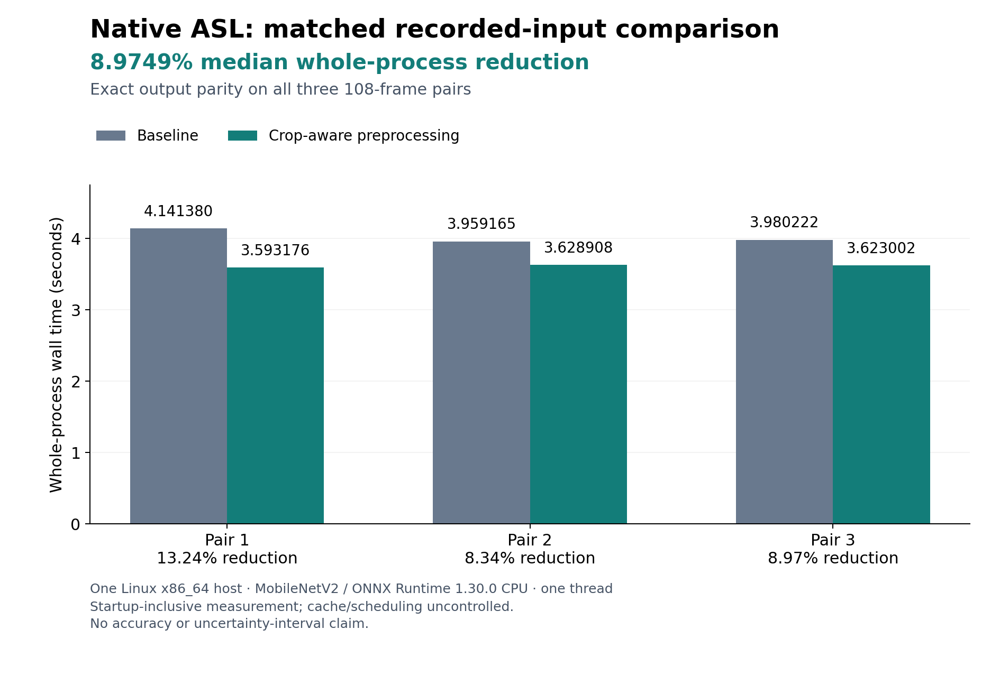
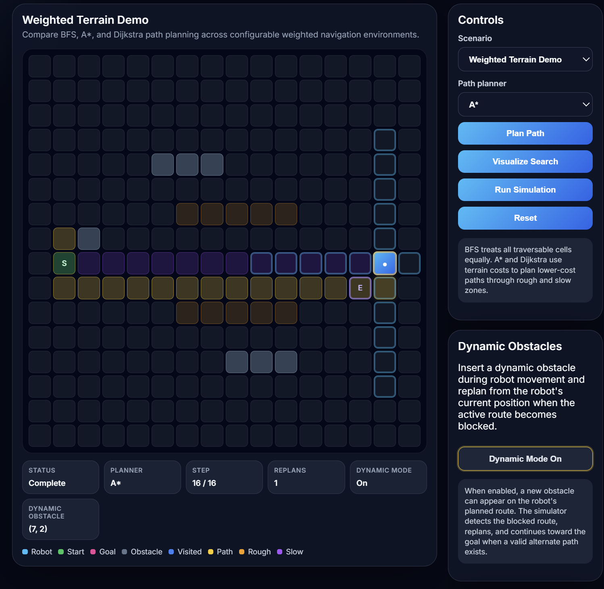
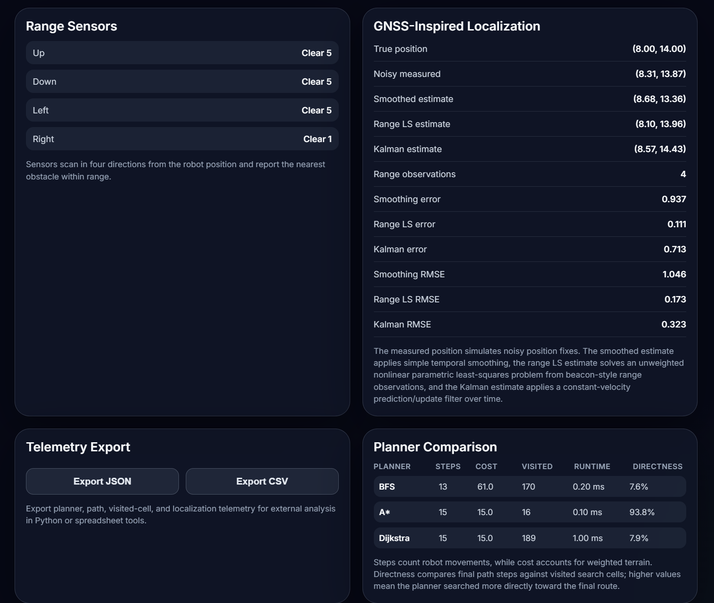

# Autonomy Simulation Lab


Replay recorded sensing data, compare processing configurations and inspect
changed frames alongside timing and spatial context. A separate browser simulator
explores planning and localization with synthetic measurements.

[Live simulator](https://kushrishi.github.io/autonomy-simulation-lab/) ·
[Native walkthrough](native/INSTALLED_RECORDING_WORKFLOW.md) ·
[Roadmap](ROADMAP.md) · [MIT license](LICENSE)

## Choose a workflow

| Workflow | What you can do | Current status |
| --- | --- | --- |
| Native C++/Python replay | Verify frame/model identity, execute CPU inference, compare outputs and inspect an optional Rerun recording. | Bounded engineering case study in maintenance. Installed 108-frame comparison passed; an older complete viewer packet is retained. Owner-side Mac graphical inspection passed for both accepted recordings in Rerun 0.38.1 at frames 0, 53, 107, 95, 93 and 94. Historical residue remains unexplained; independent first use and close/reopen persistence remain unestablished. No native release is published. |
| Browser simulator | Compare grid planners, add obstacles, inspect noisy localization and export telemetry. | [v1.0.2](https://github.com/Kushrishi/autonomy-simulation-lab/releases/tag/v1.0.2), feature-complete for this educational scope; maintenance only. |

## Native replay

The original C++ crop-aware preprocessing optimization avoids computing resized
pixels that the center crop discards, while preserving filtering coefficients,
rounding and accumulation order. Three matched 108-frame pairs retained exact
model-output parity: **8.9749% median reduction in whole-process wall time** and
**57.5238% median reduction in summed per-frame preprocessing time**. These are
different measurements, on one Linux host, one MobileNetV2 model and one workload;
startup, cache and scheduling were not fully controlled. No accuracy improvement
or general throughput guarantee is established.



[Recorded timing table and figure provenance](docs/assets/publication/README.md) ·
[Original accepted figure, preserved](docs/assets/native_asl_matched_wall_time.png)

See the [controlled replay case study](native/CONTROLLED_REPLAY_CASE_STUDY.md)
for all pairs, source identities, ordinary-script comparison and limitations.
ASL implements the preprocessing, input contracts and comparison integration;
ONNX Runtime, MobileNetV2, KITTI, libpng and Rerun supply their respective runtime,
model, data, decoder and viewer.

The runner validates timestamps and consumed file bytes, decodes bounded PNG
images, applies an explicit preprocessing contract and executes a pinned ONNX
Runtime CPU model. Python tools compare per-frame predictions, missing or reordered
frames, configuration identity and latency. Optional Rerun export connects those
results with camera imagery, ENU positions and synchronization skew.

Start with [build/install and the included synthetic example](native/USABILITY.md).
Then follow the [installed recording-to-viewer workflow](native/INSTALLED_RECORDING_WORKFLOW.md)
for your authorized recording and compatible model. The model, viewer and dataset
have separate dependencies; this is not a one-command universal binary.

The [real-recording validation](native/INSTALLED_RECORDING_VALIDATION_2026_10_10.md)
covered all 108 original frames using a relocated installation. Both preprocessing
runs completed and the fresh baseline matched retained numerical outputs exactly.
Candidate output residue was subsequently observed and preserved; the comparison
now flags residue after process exit. Its original cause remains unresolved.

See [release acceptance](native/RELEASE_READINESS_2026_10.md) for the remaining
requirements. Same-host repeatability and changed predictions do not establish
perception accuracy, sensor fusion or cross-platform determinism.
The older complete viewer packet and the incomplete newer provenance packet
are distinct retained artifacts. The owner independently restored the accepted
baseline/candidate comparison archive, verified both recording hashes and completed
bounded graphical inspection on an Apple Silicon Mac. Twelve full-resolution
screenshots were reviewed and retained privately; no KITTI imagery is redistributed
here. This is owner-side acceptance, not independent first use, perception accuracy
or a close/reopen persistence result. No inference was rerun for this inspection.

## Browser simulator



Run BFS, A* or Dijkstra on an editable grid, introduce obstacles during movement
and inspect replanning. BFS minimizes step count on an unweighted grid; A* and
Dijkstra share terrain-weighted costs. A* uses a Manhattan-distance heuristic.

Compare simulated truth with noisy position measurements, Gauss-Newton range
least-squares estimates and a constant-velocity Kalman filter. The Kalman filter
uses position observations; it does not directly fuse nonlinear beacon ranges.
This is an educational model, not a GNSS receiver or autonomous vehicle stack.



Export JSON/CSV telemetry for [Python analysis](analysis/README.md).
Tests cover planner correctness, weighted optimality, replanning helpers, input
validation, range recovery and filter behavior. The [independent numerical audit](analysis/numerical-audit/README.md)
records NumPy/SciPy comparisons and v1.0.1 corrections. The filter uses an
educational discrete Q=qI noise model; its covariance is not calibrated for the
simulator’s deterministic noise. CI runs tests and build checks.
Gauss–Newton uses a bounded iteration budget, not an established convergence
guarantee. v1.0.2 also fixes search visualization advancing movement progress;
the owner accepted search at 0/15, movement at 15/15 and reset in Weighted Terrain
Demo with Dijkstra on Mac. This is specific regression acceptance, not exhaustive
browser certification. WebKit/Safari, import workflows, small screens and
comprehensive accessibility acceptance remain incomplete; keyboard-only grid
editing is unsupported. The existing screenshots reproduce the released A*
dynamic scenario and remain representative.

From a checkout:

```bash
npm ci
npm test
npm run build
npm run dev
```

Open `http://localhost:5173/autonomy-simulation-lab/`.
On Windows PowerShell, use `npm.cmd` if script-execution policy blocks `npm`.

## Repository guide

- [Architecture](docs/architecture.md)
- [Contributing](CONTRIBUTING.md)

- [Native contracts and build options](native/README.md)
- [Recording acquisition](native/ACQUISITION.md)
- [Spatial adapters](native/SPATIAL_ADAPTERS.md)
- [Model and preprocessing contracts](native/INFERENCE.md)
- [Direction and completion criteria](ROADMAP.md)

The source is MIT licensed. Dataset and model terms remain separate; private
recordings are not distributed in this repository.
