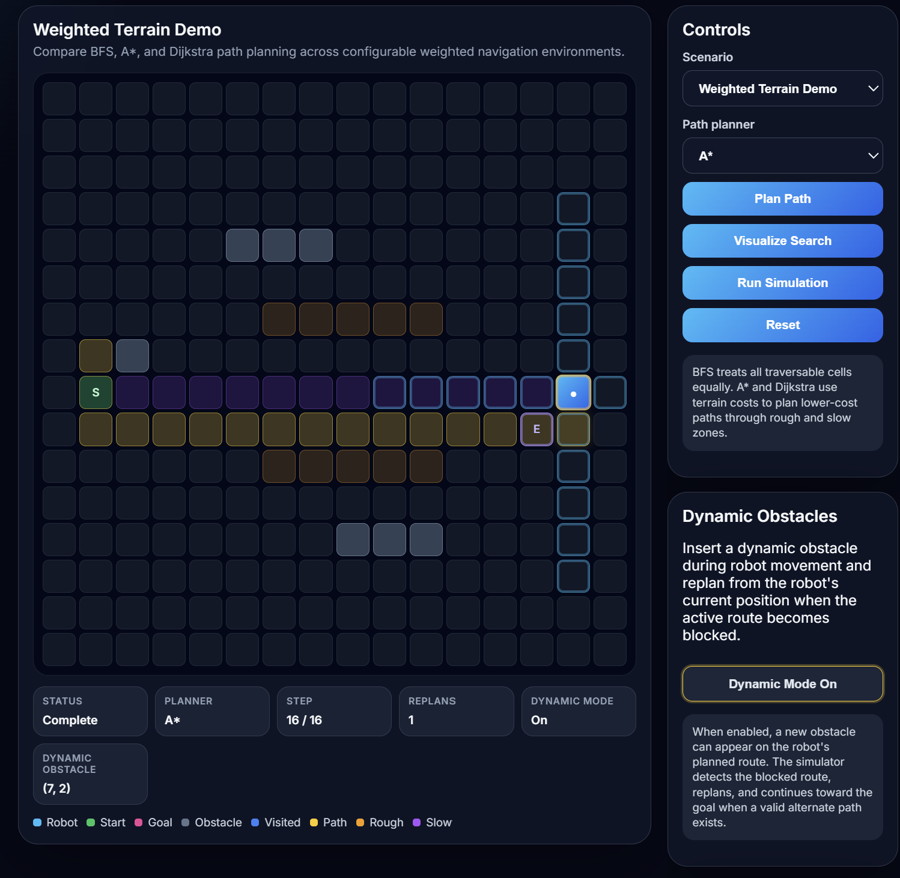
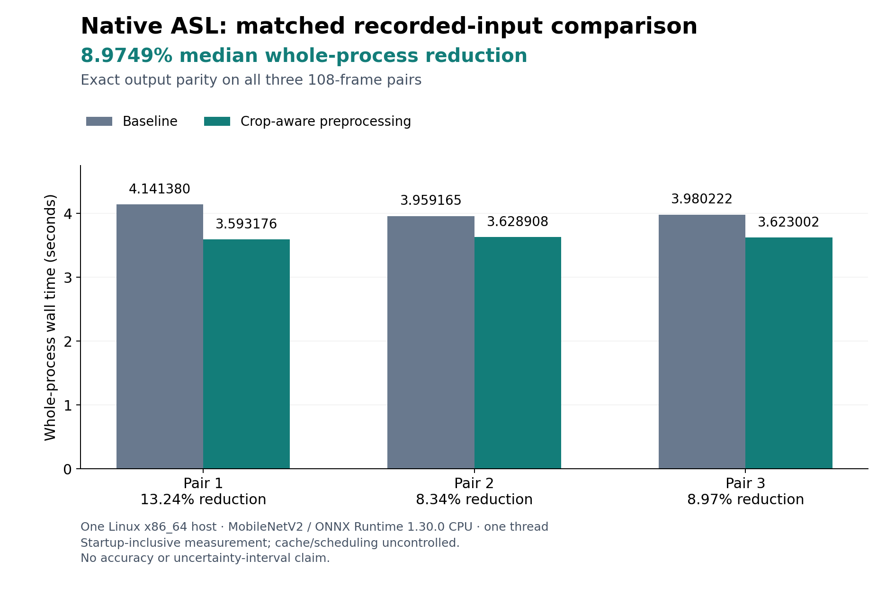

# Autonomy Simulation Lab

A browser simulator for planning and localization, with a separate C++/Python tool for replaying sensor recordings and comparing inference outputs.

[Browser demo](https://kushrishi.github.io/autonomy-simulation-lab/) · [Native quickstart](native/USABILITY.md) · [Architecture](docs/architecture.md)

## Browser simulator

Compare BFS, A* and Dijkstra, add obstacles and inspect replanning. The localization examples include range-based position estimation and a Kalman filter. Export JSON or CSV telemetry for analysis in Python.



From a checkout:

```bash
npm ci
npm test
npm run build
npm run dev
```

Open `http://localhost:5173/autonomy-simulation-lab/`. On Windows PowerShell, use `npm.cmd` if script-execution policy blocks `npm`.

The browser is an educational simulation. BFS ignores terrain weights; A* and Dijkstra use weighted costs. The Kalman filter takes position observations, not raw beacon ranges. The simplified noise model does not provide calibrated uncertainty.

Select an editor tool, then use Tab to enter the grid, arrow keys to move and Enter or Space to edit. Home/End move to the row edges; Ctrl+Home/End move to the first/last cell. Tab leaves the grid. Editing is paused during animation. These controls are in the current demo and main branch; the [v1.0.2 tag](https://github.com/Kushrishi/autonomy-simulation-lab/releases/tag/v1.0.2) predates them.

[Telemetry analysis](analysis/README.md) · [Numerical checks and corrections](analysis/numerical-audit/README.md)

## Native replay

The native runner checks recording files and timestamps, preprocesses images and runs a fixed ONNX Runtime CPU model. Python tools compare frame order, predictions and timing. Optional Rerun export adds imagery and spatial context.

A crop-aware C++ preprocessing path avoids calculating pixels that the final center crop discards. In three paired runs of the same 108-frame workload, median whole-process time fell by **8.97%**, with identical recorded model outputs. The separately measured preprocessing stage fell by **57.52%**.



These measurements used one Linux host and MobileNetV2. Startup was included; cache and scheduling were not fully controlled. They describe this workload, not a general speedup.

[Measurements and method](native/CONTROLLED_REPLAY_CASE_STUDY.md) · [Figure source](docs/assets/publication/README.md)

Start with the [included synthetic example](native/USABILITY.md), then follow the [recording walkthrough](native/INSTALLED_RECORDING_WORKFLOW.md). The model, viewer and system dependencies are installed separately.

### Known issues

The native tool has no packaged release. An earlier output-cleanup problem remains unexplained. Fresh-user installation and saved-viewer reopening still need testing. Detailed findings are in the [release checklist](native/RELEASE_READINESS_2026_10.md).

This tool compares recorded inference outputs; it is not a sensor-fusion or autonomous-driving system.

## Documentation and credits

[Build options](native/README.md) · [Inference](native/INFERENCE.md) · [Data acquisition](native/ACQUISITION.md) · [Project status](ROADMAP.md) · [Contributing](CONTRIBUTING.md)

ASL supplies preprocessing, validation and comparison code. ONNX Runtime, MobileNetV2, KITTI, libpng and Rerun are third-party components.

Source code is [MIT licensed](LICENSE). Dataset and model terms remain separate; private recordings are not distributed here.
